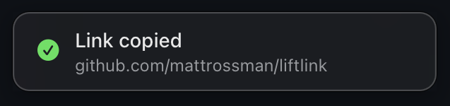

# LiftLink

Copy a link with a click.

When you're gathering context for an agent or sharing sources with someone, copying links shouldn't slow you down.

LiftLink is a small Mac app that lets you hold **Control + Option** and click a link to copy its address. A toast confirms what you copied, and the menu bar lets you change the shortcut and sound.

## Getting started

LiftLink is in early development and requires macOS 13 or later on Apple Silicon.

1. Download a [pre-release](https://github.com/mattrossman/liftlink/releases). Open the DMG and drag LiftLink to Applications. If the release only has a ZIP, unzip it and move LiftLink to Applications.
2. Open LiftLink from Applications. If macOS blocks it because it can't verify the app, open **System Settings → Privacy & Security**, scroll down, and click **Open Anyway**. Confirm the prompt. Only do this if you trust the download. See [Apple's guide to opening apps safely](https://support.apple.com/102445).

LiftLink needs Accessibility access to copy links from other apps. When prompted, enable it in **System Settings → Privacy & Security → Accessibility**, then reopen LiftLink. You may need to allow access again after updating a preview.

If LiftLink can't copy a link, it'll let you know and leave your clipboard as it was.

To build LiftLink from source, see [CONTRIBUTING.md](CONTRIBUTING.md).
